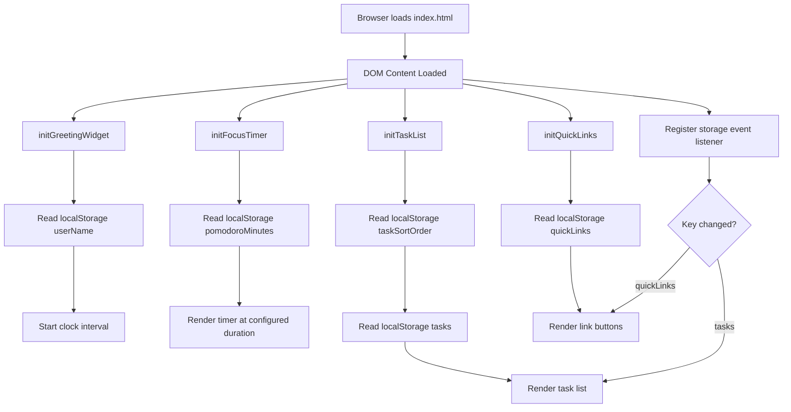
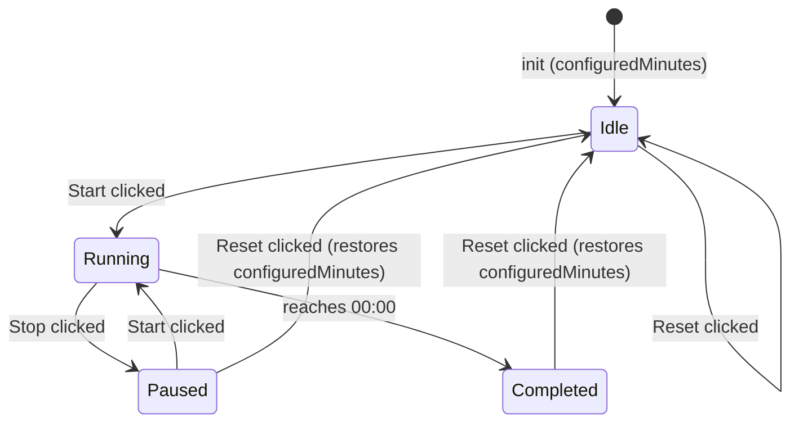

# Design Document: To-Do List Life Dashboard

## Overview

The To-Do List Life Dashboard is a self-contained, client-side single-page application (SPA) built with plain HTML, CSS, and Vanilla JavaScript — no frameworks, no build pipeline, no backend. It runs entirely in the browser and persists all state through the `localStorage` Web API.

The application is structured as a single HTML entry point (`index.html`) that loads exactly one stylesheet (`css/style.css`) and one script (`js/app.js`). On load the script initialises four independent widget modules that each manage their own DOM subtree, event listeners, and localStorage interaction:

1. **Greeting Widget** — real-time clock, date, time-of-day salutation, and a custom user name that personalises the greeting
2. **Focus Timer** — Pomodoro countdown with a user-configurable duration (1–60 minutes, default 25) and Start / Stop / Reset controls
3. **To-Do List** — full CRUD task manager with inline editing and a client-side sort control (Date Added, A→Z, Z→A, Completed Last)
4. **Quick Links** — URL shortcut launcher with Add / Delete

Cross-tab synchronisation is achieved by listening to the native `storage` event, which fires in every same-origin tab when another tab writes to `localStorage`.

---

## Architecture

### File Structure

```
index.html
css/
  style.css
js/
  app.js
```

All application logic lives in `js/app.js`. The file is organised into self-contained IIFE-style module blocks, one per widget, plus a shared utility section at the top. No module bundler or transpiler is used; the file is loaded as a standard `<script>` tag at the bottom of `<body>` (or with `defer`).

### Initialisation Flow



### Event Architecture

All user interactions use standard DOM event listeners attached at initialisation time. The task list and quick links use **event delegation** on their container elements to avoid re-attaching listeners on every render. Timer controls use direct listeners on the three buttons.

The `storage` event on `window` handles cross-tab synchronisation: when `localStorage` is modified in another tab, the listener re-reads the relevant key and re-renders the affected widget.

---

## Components and Interfaces

### Shared Utilities

```js
// Reads a JSON value from localStorage; returns fallback on missing or parse error
function storageGet(key, fallback) { … }

// Writes a JSON value to localStorage; returns false and shows error on quota/security error
function storageSet(key, value) { … }

// Displays a transient error banner in the UI
function showError(message) { … }

// Trims a string and returns null if the result is empty
function sanitise(str) { … }
```

### Greeting Widget

**Responsibilities:** render current time and date; display contextual greeting; update every 60 seconds via `setInterval`; handle clock unavailability; support a custom user name that personalises the greeting.

**Public interface (internal module):**

```js
function initGreetingWidget() {
  // Reads Date(), formats time/date strings, determines greeting tier,
  // reads userName from localStorage, writes to DOM, then schedules
  // a 60-second interval for updates.
}
```

**Greeting tier logic:**

| Hours (local) | Message        |
|---------------|----------------|
| 05 – 11       | Good Morning   |
| 12 – 17       | Good Afternoon |
| 18 – 21       | Good Evening   |
| 22 – 04       | Good Night     |

The tier is a pure function of the hour value, making it straightforward to test.

**Custom user name:**

- On init, `userName` is read from localStorage via `storageGet("userName", "")`.
- If `userName` is non-empty, the greeting renders as `"{tier}, {userName}"` (e.g., "Good Morning, Robby").
- If `userName` is an empty string, the greeting renders without a name suffix.
- The Greeting_Widget renders a `<input type="text">` name field and a Save button inside its DOM section.
- On Save: the input value is passed through `sanitise()`; if the result is non-null (non-empty after trimming), the value is written to `localStorage["userName"]` and the greeting is re-rendered with the name; if the result is null (empty or whitespace-only), the `"userName"` key is removed from localStorage and the greeting re-renders without a name suffix.

### Focus Timer

**Responsibilities:** maintain countdown state (`remaining`, `running`, `configuredMinutes`); drive a 1-second `setInterval` while running; update MM:SS display; enforce control enable/disable rules; show completion indicator; support a user-configurable duration persisted to localStorage.

**Initialisation:**

On init, `pomodoroMinutes` is read from localStorage via `storageGet("pomodoroMinutes", 25)`. The value is clamped to the range [1, 60]. This becomes `configuredMinutes`. `remaining` is set to `configuredMinutes * 60`.

**Duration input:**

- A `<input type="number" min="1" max="60">` duration control is rendered inside the Focus_Timer section.
- The duration input is **visible and enabled only in the Idle state**; it is hidden or disabled in Running, Paused, and Completed states.
- When the user changes the duration input while Idle: validate that the value is an integer in [1, 60]; if valid, update `configuredMinutes`, set `remaining = configuredMinutes * 60`, persist to `localStorage["pomodoroMinutes"]`, and update the MM:SS display; if invalid, ignore and retain the current `configuredMinutes`.

**`resetTimer()`** sets `remaining = configuredMinutes * 60` (not a hardcoded 1500).

**State machine:**



**Button and input enable/disable rules by state:**

| State     | Start    | Stop     | Reset    | Duration input |
|-----------|----------|----------|----------|----------------|
| Idle      | enabled  | disabled | enabled  | enabled        |
| Running   | disabled | enabled  | enabled  | disabled       |
| Paused    | enabled  | disabled | enabled  | disabled       |
| Completed | disabled | disabled | enabled  | disabled       |

The timer state is **not** persisted to `localStorage` — it is intentionally session-only, consistent with the requirements (no persistence requirement for the timer countdown state).

### To-Do List

**Responsibilities:** render task list from in-memory array; handle add, inline-edit, toggle-complete, and delete operations; persist to `localStorage["tasks"]` after every mutation; respond to `storage` events from other tabs; support client-side sort without mutating the underlying data.

**Inline edit mode:** at most one task can be in edit mode at a time. Opening a second task's editor cancels the first without saving (Requirement 6.6).

**Render strategy:** full re-render of the task list `<ul>` on every state change. Because task lists are typically small (< a few hundred items), a full re-render is performant and simpler than a diffing approach. The render function builds a document fragment and swaps it in atomically to avoid layout thrashing.

**Sort control:**

- An in-memory `activeSortOrder` variable holds the current sort selection, defaulting to `"dateAdded"`.
- On init, `activeSortOrder` is read from localStorage via `storageGet("taskSortOrder", "dateAdded")`.
- A `<select>` sort control is rendered with the following options:

  | Value           | Label           |
  |-----------------|-----------------|
  | `"dateAdded"`   | Date Added      |
  | `"az"`          | A → Z           |
  | `"za"`          | Z → A           |
  | `"completedLast"` | Completed Last |

- `getSortedTasks(tasks, order)` is a **pure function** that returns a sorted copy of the tasks array and never mutates the original:
  - `"dateAdded"` — returns a shallow copy in original insertion order (no sort applied)
  - `"az"` — sorts ascending by `description.toLowerCase()`
  - `"za"` — sorts descending by `description.toLowerCase()`
  - `"completedLast"` — stable sort: tasks with `completed === false` appear before tasks with `completed === true`; relative order within each group is preserved
- `renderTaskList()` calls `getSortedTasks(tasks, activeSortOrder)` to obtain the display order, then renders from that sorted copy.
- When the sort control changes: update `activeSortOrder`, persist to `localStorage["taskSortOrder"]`, and re-render.
- The underlying `tasks` array is **never mutated by sort** — it always stays in insertion order so that "Date Added" always reflects the true creation sequence.

### Quick Links

**Responsibilities:** render link buttons from in-memory array; handle add and delete; validate URL scheme; open URLs in new tab; persist to `localStorage["quickLinks"]` after every mutation; respond to `storage` events.

**URL validation:** a URL is valid if it passes `url.startsWith("http://") || url.startsWith("https://")`. Full URL parsing via the `URL` constructor is used as a secondary guard to catch malformed URLs.

---

## Data Models

### Task

```js
{
  id: string,          // crypto.randomUUID() or Date.now().toString()
  description: string, // trimmed, 1–500 characters
  completed: boolean,  // default: false
  createdAt: number    // Date.now() timestamp, used to preserve creation order
}
```

Tasks are stored as a JSON-serialised array under `localStorage["tasks"]`.

**Validation rules:**
- `description` after trimming must have length ≥ 1 and ≤ 500 (create), ≤ 255 (edit)
- `completed` must be a boolean
- On load, any item failing validation is dropped and the remaining valid items are rendered

### Link

```js
{
  id: string,    // crypto.randomUUID() or Date.now().toString()
  label: string, // trimmed, 1–100 characters
  url: string    // must start with http:// or https://, max 2048 characters
}
```

Links are stored as a JSON-serialised array under `localStorage["quickLinks"]`.

**Validation rules:**
- `label` after trimming must have length ≥ 1 and ≤ 100
- `url` must start with `http://` or `https://` and be ≤ 2048 characters
- On load, any item failing validation is dropped silently

### localStorage Schema

| Key              | Type             | Widgets that read/write      |
|------------------|------------------|------------------------------|
| `"tasks"`        | `Task[]` (JSON)  | To-Do List                   |
| `"quickLinks"`   | `Link[]` (JSON)  | Quick Links                  |
| `"userName"`     | string (JSON)    | Greeting Widget              |
| `"pomodoroMinutes"` | number (JSON) | Focus Timer                  |
| `"taskSortOrder"` | string (JSON)   | To-Do List                   |

The `"tasks"` and `"quickLinks"` keys are intentionally separate (Requirement 11.1).

**Validation rules for new keys:**

- `"userName"`: string; trimmed length 0–100; an empty string means no name is saved and the greeting renders without a name suffix.
- `"pomodoroMinutes"`: integer in range [1, 60]; if missing or out of range, defaults to 25.
- `"taskSortOrder"`: one of `"dateAdded"` | `"az"` | `"za"` | `"completedLast"`; if missing or an unrecognised value, defaults to `"dateAdded"`.

---

## Error Handling

### localStorage Errors

`localStorage` can throw `SecurityError` (private browsing with storage blocked) or `QuotaExceededError`. Both are caught in `storageSet()`:

```js
function storageSet(key, value) {
  try {
    localStorage.setItem(key, JSON.stringify(value));
    return true;
  } catch (e) {
    showError("Changes could not be saved permanently.");
    return false;
  }
}
```

When `storageSet` returns `false`, the in-memory array has already been updated, so the widget continues to work for the current session (Requirements 7.4, 9.5, 11.4).

### Corrupt localStorage Data

On load, `storageGet` wraps `JSON.parse` in a try/catch. If parsing fails or the result is not an array, it returns the fallback value (`[]`) and calls `showError` with an appropriate message (Requirements 9.4, 11.5).

### Clock Unavailability

`new Date()` can return an `Invalid Date` if the system clock is unavailable (rare, but possible in some sandboxed environments). The Greeting Widget checks `isNaN(date.getTime())` and renders the error state instead of a stale time (Requirement 1.5).

### Error Banner Pattern

A single `<div id="error-banner">` is positioned at the top of the page. `showError(message)` sets its `textContent`, makes it visible, and sets a 5-second auto-dismiss timeout via `setTimeout` that hides the banner again.

---

## Manual Verification

Before considering a task complete, verify the following in the browser:

- Open `index.html` directly in Chrome, Firefox, Edge, or Safari — all four widgets render and are interactive.
- No JavaScript errors appear in the browser console during normal operation.
- After interacting with each widget (add task, edit task, complete task, delete task, add link, delete link, save name, set Pomodoro duration, sort tasks), close and reopen the tab — data is restored from localStorage.
- The timer counts down correctly, Start/Stop/Reset behave as specified, and the duration input is only available in Idle state.
- The sort control re-orders the displayed list without altering task data or completion states.
- The greeting displays the saved name when one is set, and reverts to the plain greeting when the name is cleared.
